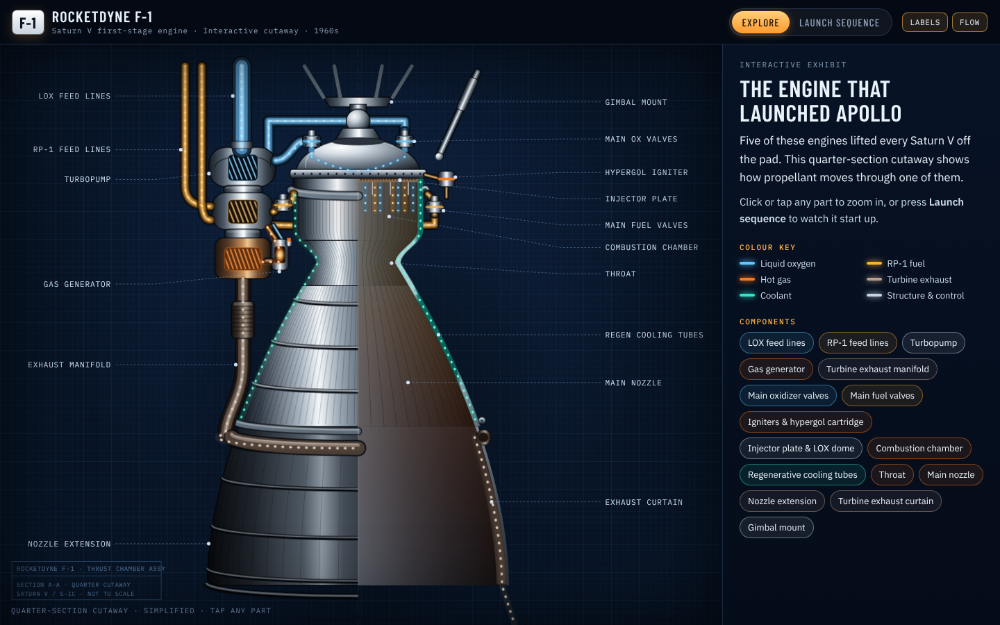

# Rocketdyne F-1 Explorer

An interactive, museum-style cutaway of the Rocketdyne F-1 — the engine that powered the Saturn V first stage on the Apollo missions.

- Click or tap any of 16 components to zoom in and read how it works, with key figures and a "why it matters" fact
- Play the **Launch sequence** (9 steps, from tank pressurisation to five engines firing on the Saturn V)
- Stats dashboard, key facts, Apollo context and a glossary

It is a single static page (`index.html`) with no build step and no dependencies other than Google Fonts, which fall back to system fonts when unavailable.

Figures are published F-1 specifications for the uprated flight engine. The cutaway is a simplified illustration; proportions are approximate.

## Run locally
Open `index.html` in any modern browser.

## Hosting
Served with GitHub Pages straight from the `main` branch root.
